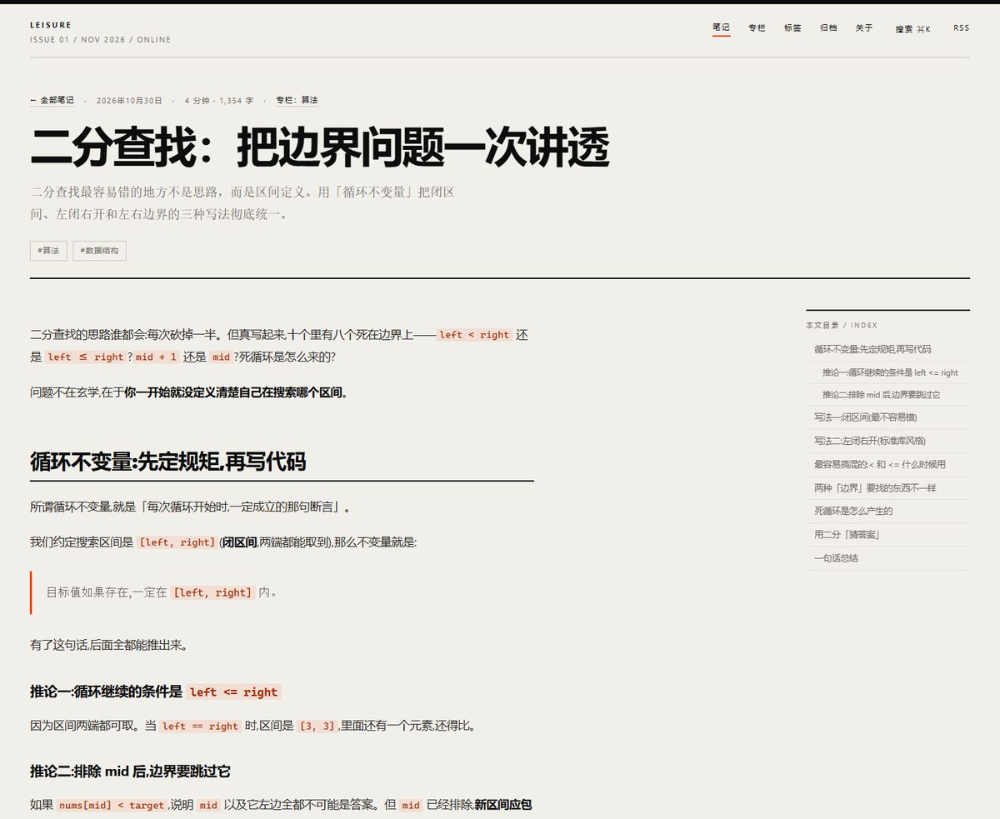

# Leisure 的代码笔记 · 个人博客

🌐 线上地址：**<https://leisure23.github.io>** ｜ 仓库：<https://github.com/leisure23/leisure23.github.io>

一个用 [Astro](https://astro.build) 写的静态博客，走的是「印刷海报」风格：米白纸、墨黑、朱红三色，
超大字号排版、倾斜的专栏黑条。文章是纯 Markdown 文件，构建出来是一堆 HTML，没有数据库、没有后端、
没有月费，用 GitHub Pages 免费托管。




## 一、先跑起来

需要 Node.js 20.3 以上。

```bash
npm install        # 第一次才需要
npm run dev        # 本地预览 http://localhost:4321
```

想看「真正发布出去的版本」：

```bash
npm run build      # 产物在 dist/
npm run preview    # 预览构建产物
```

## 二、写一篇文章

```bash
npm run post "二分查找的边界问题" binary-search-boundaries
```

会在 `src/content/blog/` 生成模板，frontmatter 已填好。第二个参数是文件名（也会进网址），**建议用英文**。

frontmatter 字段：

| 字段 | 必填 | 说明 |
| --- | --- | --- |
| `title` | ✅ | 标题 |
| `description` | ✅ | 摘要，列表页和 SEO 都用它 |
| `pubDate` | ✅ | `2026-11-03` 这种格式 |
| `tags` | | 标签，决定文章进哪个专栏、出现在哪些标签页 |
| `emoji` / `hue` | | 预留字段，当前设计没用到 |
| `featured` | | 预留字段 |
| `draft` | | `true` 时本地可见、正式发布不构建 |

写完：

```bash
git add -A && git commit -m "新增：二分查找" && git push
```

推送后约 1 分钟自动上线，**不需要手动 build**。

## 三、目录结构

```
├── astro.config.mjs            # 站点配置（一般不动）
├── src/
│   ├── consts.ts               # ⭐ 站名、期号、大字文案、专栏、公告都在这
│   ├── content.config.ts       # 文章 frontmatter 规则
│   ├── content/blog/           # ⭐ 文章，一个 .md 一篇
│   ├── styles/global.css       # ⭐ 配色、字号、倾斜角度、hover 效果
│   ├── components/
│   │   ├── Masthead.astro      # 页眉导航
│   │   ├── ColumnBand.astro    # 倾斜的专栏黑条
│   │   ├── PostRow.astro       # 文章行（hover 放大）
│   │   ├── Notice.astro        # 公告模块
│   │   ├── SearchPalette.astro # ⌘K 搜索
│   │   ├── Footer.astro
│   │   └── Icon.astro
│   ├── layouts/BaseLayout.astro # 页面骨架 + 全站交互脚本
│   └── pages/                  # / /blog /columns /tags /archive /about /notice /404
├── scripts/new-post.mjs        # npm run post 用的脚本
└── .github/workflows/deploy.yml # 自动部署
```

带 ⭐ 的三处，是你以后 95% 时间会碰的。

## 四、改成你自己的

### 1. 首屏那三行大字（`src/consts.ts`）

```ts
export const HERO = {
  kicker: 'Notes on Code & Theory',
  lines: [
    { text: '还没想好', style: 'solid'   },  // 实心黑
    { text: '这里',     style: 'outline' },  // 描边空心
    { text: '写什么。', style: 'accent'  },  // 朱红
  ],
  vertical: '从「知道」往「为什么」再挖一层',
  ghostYear: '2026',
};
```

- 想加一行：数组里多写一条
- 想换样式：`style` 改成 `solid` / `outline` / `accent`
- 想换行位置：数组怎么切，页面就怎么排

### 2. 专栏黑条上的模块（同一个文件）

```ts
export const COLUMNS = [
  { slug: 'algo', name: '算法', tags: ['算法'] },
  { slug: 'network', name: '计算机网络', tags: ['计算机网络', 'TCP'] },
  // 加一条就多一格，篇数按 tags 自动统计
];
```

- `slug` 决定网址：`/columns/algo/`
- `tags` 决定收录哪些文章（多个标签取并集）
- 篇数是**自动算的**，不用手改

### 3. 公告（同一个文件）

```ts
export const NOTICES = [
  {
    updated: '2026-11-03',
    publishedAt: '2026-11-03 21:40',
    html: '十一月计划：把 TCP 那篇的<b>时序图</b>补上……',
  },
];
```

最新一条显示在首页右侧，全部显示在 `/notice/`。支持 `<b>` 做荧光笔标记。

### 4. 配色与倾斜角度（`src/styles/global.css`）

```css
:root {
  --bg: #f1efea;      /* 纸 */
  --ink: #0d0d0d;     /* 墨 */
  --accent: #ff3b00;  /* 朱红 */
  --mark: #ffe08a;    /* 荧光笔 */
  --band-tilt: -1.4deg;  /* 黑条倾斜角度，改这里就行 */
}
```

### 5. 页眉期号

`consts.ts` 里的 `SITE.issue`，现在写的是 `ISSUE 01 / NOV 2026 / ONLINE`。

## 五、两个交互动效在哪

| 效果 | 代码位置 |
| --- | --- |
| 鼠标划过黑条模块，黑格变成页面米白色 | `global.css` 里 `.band a.mod:hover` |
| 鼠标划过文章标题，标题放大 4.5% | `global.css` 里 `.row:hover .row-title` |

放大用的是 `transform: scale()`，不会引起重排、也不会抖动。

## 六、部署（已完成，留档）

1. Git 装在 `C:\D\Git`，版本 2.56.0.windows.4
2. 仓库 `leisure23/leisure23.github.io`，默认分支 `main`
3. 首次推送用的是 Personal Access Token（写进了 `.git/config` 的 remote 地址，90 天过期）
4. Pages 的 Source 必须选 **GitHub Actions**（不是 `Deploy from a branch`）
5. 之后每次 `git push` 自动构建发布，约 1 分钟

## 七、常见问题

**问：文章没出现？** 检查 `draft` 是不是 `true`，`pubDate` 是不是合法日期。

**问：黑条在缩放时压住了下面的字？**
已经修好了。旋转后的元素不占布局空间，所以外面套了一个固定高度的 `.band-slot` 占位，
无论浏览器缩放多少倍都不会压到内容。

**问：能用数学公式吗？** 可以，装 `remark-math` + `rehype-katex`，在 `astro.config.mjs` 的
`markdown` 里加 `remarkPlugins` / `rehypePlugins`，再引一行 katex 的 CSS。

**问：能加评论吗？** 推荐 [giscus](https://giscus.app)，把官网给的 `<script>` 塞进
`src/pages/blog/[...id].astro` 底部。

**问：想换回深色主题？** 现在这套是纯浅色设计（纸+墨+朱红）。要深色得改 `--bg` / `--ink` 两个变量，
但黑色黑条会跟背景糊在一起，需要一起调整。

## 八、技术栈

- [Astro 6](https://astro.build) — 静态站点框架，默认零 JS
- Shiki — 代码高亮，构建时生成，无运行时开销
- `@astrojs/sitemap` — 站点地图
- GitHub Actions — 自动构建部署

> RSS 功能已经移除（`rss.xml` 不再生成）。`@astrojs/rss` 这个包还留在 `package.json` 里但没用了，
> 想彻底清掉可以运行 `npm uninstall @astrojs/rss`。
